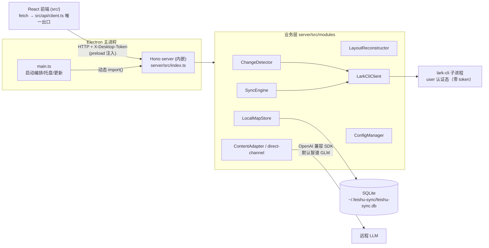
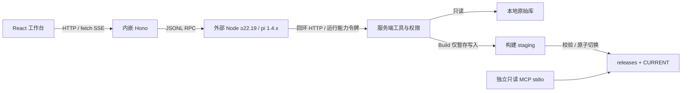

# 架构与模块地图

> 锚点声明：本文结构与代码实测对齐（2026-10，v0.3.47 基线）。模块职责的权威细节在源码头注释，本文是导航图，不复制全部细节。

## 三层同进程架构

Electron 主进程内嵌 Hono server（**不是独立进程**）→ 业务模块 → SQLite；React 前端通过 preload bridge 调 server。

## 进程与启动契约

| 契约 | 内容 | 锚点 |
|------|------|------|
| server 加载 | 生产 `app.asar.unpacked/server/dist/index.js`；开发 `../server/dist/index.js` | `electron/main.ts` |
| 端口 | Electron 下传 `0`（系统分配）回注前端；standalone 固定 `127.0.0.1:3001` | `server/src/index.ts` |
| 鉴权 | `X-Desktop-Token`（crypto.randomBytes(32)）+ Origin/Referer 校验；仅 `desktopMode=true` 挂 auth；`/api/health` 永远 public 且先注册 | 同上 |
| CORS | 由显式 `corsDevMode` 参数驱动（`dev:all` 才需要放行 `localhost:5173`），**不**由 desktopMode 决定 | `CreateServerOptions.corsDevMode` 注释 |
| DI | `buildServer()` 实例化全部模块，`app.use('*')` 挂到 context 属性（`(c as any).configManager` 等，并非 `c.env`）；**该中间件必须挂在 auth 之前**；路由从 context 同名属性取依赖，不 new 实例 | `server/src/index.ts` |
| 前端出口 | `src/api/client.ts` 是唯一 fetch 出口；桌面 token 经 preload `window.desktop.getApiHeaders()` | grep 全 src 仅此一处 |

## 模块地图（server/src）

- **modules/**（32 文件）：业务核心。按规模与变更频率排序的入口：
  - `sync-engine.ts`（1800+ 行）：同步引擎。分型读取(docx/sheet/slides) → 媒体引用解析/下载 → 本地引用重写 → staged 原子提交 → 推进 synced 基线
  - `local-map-store.ts`（2200+ 行）：SQLite 映射与状态库，better-sqlite3 同步 API + 预编译语句
  - `change-detector.ts`（1700+ 行）：wiki 子树变更检测（obj_edit_time 对比）；检测**只推进 observed 字段**
  - `layout-reconstructor.ts`：A/B/C/D/E 五类块表格重构（块规则注释在文件头）
  - `content-backend*.ts` + `direct-channel.ts`：LLM 单通道（OpenAI SDK → 智谱 GLM 默认）；registry `getFallback()` 恒 null，失败由 B6 确定性结果兜底
  - `lark-cli-client.ts` / `lark-cli-manager.ts`：lark-cli 子进程封装（QPS 节流、错误分类、99991400 指数退避）
  - `config-manager.ts`：`watchedRoots` 真相源；`watchedRootUrls` 是内存派生投影
- **routes/**：HTTP 路由，从 context 同名属性取依赖；前缀在路由文件内写死后 `app.route('/', xxxRoutes)` 挂载
- **agent/**（开发分支）：外部运行时发现、pi JSONL RPC、进程池、工具权限、路径围栏、会话历史与 SSE；`pi-extension/` 只负责转发，权限裁决留在 server
- **kb/**（开发分支）：原始源快照、构建/覆盖校验、不可变发布、CURRENT 指针、已发布内容查询
- **mcp/**（开发分支）：只读 stdio 入口；构建为无 SQLite 原生依赖的独立 CJS

## Agent 侧车与标准库（开发分支）

Hono 仍内嵌 Electron 主进程。新增的外部进程是 pi，而不是另起一套业务 server；开发和独立 server 共用同一套业务实现。

- Discuss 不暴露本地写工具；Work 仅在显式授权 Workspace 内操作文件，无 shell。运行代码/凭据、原始库和标准库均须与 Workspace 隔离，不能仅靠 prompt 约束。
- 新构建失败不能沿用原同步引擎的 DB 回滚语义：标准库以 CURRENT 为发布真相，指针提交后的状态库故障应对账，不得误删当前 release。两条流水线的原子提交实现分开维护。
- 原始源集合依据成功本地版本与文件/hash，不按云端 observed/status 直接删源；sheet CSV 附件使用相同读取围栏。
- 使用说明见 [agent-knowledge.md](./agent-knowledge.md)，完整 API/安全契约见 [设计文档](./design/agent-knowledge-design.md)。

## 关键不变量（改动前必读）

1. **synced 基线推进契约**：只有 staged 原子提交成功才推进 `synced_obj_edit_time` 并置 `synced`。资源缺失/下载失败/提交异常一律不推进（`sync-engine.ts`）。
2. **原子提交顺序**：staging → 校验 → rename → DB 事务，不可重排；文件已提交但 DB 失败时走回滚（`atomic-commit.ts`，`SyncEngineTestHooks` 验证）。
3. **双身份互斥**：`custom_folder_id` 与 `watched_root_*` 不得并存；结构树所有权优先。回填不清 `wiki_node_token`；飞书树出口必须按 `customFolderId IS NULL` 过滤归档行（两处视图）。
4. **零飞书 token**：代码中不得出现任何飞书 token/app_id/app_secret；全部委托 lark-cli user 认证态。
5. **Markdown header round-trip**：`generateHtmlHeader` 写、`IndexScanner.parseMetadata` 读，当前规范为文件首部 YAML-in-HTML-comment（另兼容 3 种历史格式）。改字段必须同步两端并有 round-trip 用例。

## Electron 侧（electron/）

`main.ts`（启动编排）+ `preload.ts`（context bridge）+ 服务文件：`tray-service` / `updater-service`（autoDownload=false）/ `auto-start-service` / `change-notification-service` / `quit-coordinator`（退出前切断 server 连接来源，否则 `server.close()` 等不完）。
