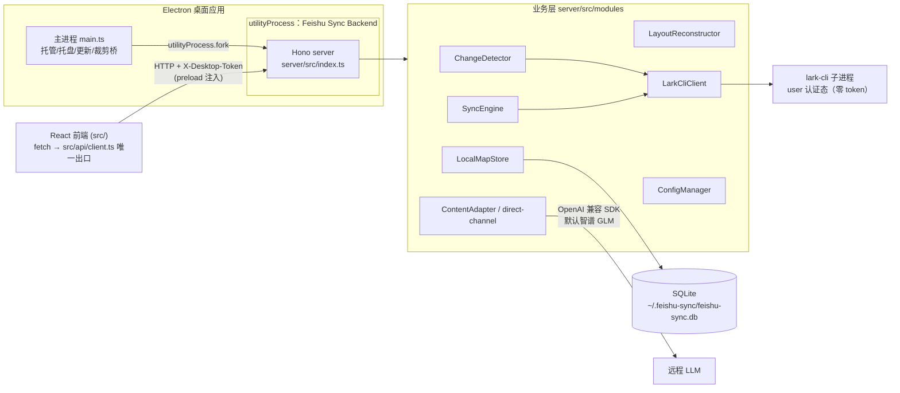
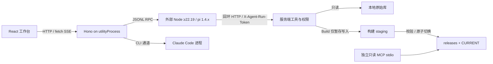

# 架构与模块地图

> 本文结构与代码实测对齐（2026-11，v0.4.24）。文中文件数/行数为该时点 `find`/`wc -l` 实测，随开发滚动，以目录为准；模块职责的权威细节在源码头注释，本文是导航图，不复制全部细节。

## 总体架构（三层）

桌面形态下，业务 Hono server 运行在 Electron 主进程托管的 **utilityProcess** 子进程中（`utilityProcess.fork`，服务名 `Feishu Sync Backend`）→ 业务模块 → SQLite；React 前端（渲染进程）通过 preload bridge 调 server。业务负载（HTTP/SQLite/工作簿解析/agent 工具）因此不占主进程 UI/生命周期线程（`electron/server-process.ts` 头注释）；唯一的反向桥是 vision 图片裁剪——utilityProcess 不暴露 `nativeImage`，经消息通道回调主进程执行。standalone 模式（`npm run dev:all` / `node server/dist`）用同一份业务实现跑独立 Node 进程。

## 进程与启动契约

| 契约 | 内容 | 锚点 |
|------|------|------|
| 进程模型 | 业务 server 运行在 Electron **utilityProcess** 子进程：主进程 `startEmbeddedServer` → `server-process.ts` `utilityProcess.fork`（`dist-electron/server-process-entry.cjs` 为子进程入口），主进程托管生命周期、转发 stdio；vision 图片裁剪经 IPC 回主进程（utilityProcess 不暴露 nativeImage）。standalone 为独立 Node 进程 | `electron/main.ts`、`electron/server-process.ts` |
| server 加载 | utility 子进程内动态 `import()` server：生产 `app.asar.unpacked/server/dist/index.js`；开发 `../server/dist/index.js` | `electron/server-process-entry.ts`、`electron/server-process.ts` |
| 端口 | Electron 下传 `0`（系统分配）回注前端；standalone 固定 `127.0.0.1:3001` | `server/src/index.ts` |
| 鉴权 | `X-Desktop-Token`（crypto.randomBytes(32)）+ Origin/Referer 校验；仅 `desktopMode=true` 挂 auth；`/api/health` 永远 public 且先注册 | 同上 |
| CORS | 由显式 `corsDevMode` 参数驱动（`dev:all` 才需要放行 `localhost:5173`），**不**由 desktopMode 决定 | `CreateServerOptions.corsDevMode` 注释 |
| DI | `buildServer()` 实例化全部模块，`app.use('*')` 挂到 context 属性（`(c as any).configManager` 等，并非 `c.env`）；**该中间件必须挂在 auth 之前**；路由从 context 同名属性取依赖，不 new 实例 | `server/src/index.ts` |
| 前端出口 | `src/api/client.ts` 是唯一 fetch 出口；桌面 token 经 preload `window.desktop.getApiHeaders()` | grep 全 src 仅此一处 |

### 令牌域（三域 + 内部域，互不越界）

| 域 | 载体 | 校验 | 隔离 |
|----|------|------|------|
| desktop token | `X-Desktop-Token` | `middleware/auth.ts`（Origin/Referer + timing-safe） | 管理面唯一入口：`/api/cli/*` 管理、config 修改（含 `cli.*`/`llm.*` 密钥面）、全部业务 API |
| CLI 令牌 | `X-Cli-Token` | `middleware/cli-auth.ts` 三重校验：回环 Host + 无 Origin + timing-safe | 不进 `/api/agent-internal/*`；desktop 域不接受 CLI 令牌 |
| LAN Bearer | `Authorization: Bearer`（token-store 摘要比对） | `kb-lan/http-gateway.ts`（401×10 → 429 封禁 5min） | 仅 LAN MCP 端点，默认关闭 |
| agent 运行令牌 | `X-Agent-Run-Token` | `routes/agent-internal.ts` 三重校验（回环 + 无 Origin + timing-safe） | 仅外部 agent 进程回调服务端工具时使用 |

三域令牌双向隔离；`RETIRED_REQUEST_SCOPES`（`docs:document:read`）在配置加载迁移与 device flow 发起时剔除，防止上游已失效 scope 让整单授权被拒。

## 模块地图（server/src）

### modules/（约 50 个 .ts）——同步业务核心

按规模与变更频率排序的入口：

- `sync-engine.ts`（约 2700 行）：同步引擎。分型读取(docx/sheet/slides) → 媒体引用解析/下载 → 本地引用重写 → staged 原子提交 → 推进 synced 基线
- `local-map-store.ts`（约 4300 行）：SQLite 映射与状态库（22 张表 DDL/迁移都在此），better-sqlite3 同步 API + 预编译语句
- `change-detector.ts`（约 2000 行）：wiki 子树变更检测（obj_edit_time 对比）；检测**只推进 observed 字段**
- `config-manager.ts`（约 2000 行）：配置加载/归一/校验；`watchedRoots` 真相源，`watchedRootUrls` 是内存派生投影
- `layout-reconstructor.ts`：A/B/C/D/E 五类块表格重构（块规则注释在文件头）
- `content-backend*.ts` + `direct-channel.ts`：LLM 单通道（OpenAI SDK → 智谱 GLM 默认）；registry `getFallback()` 恒 null，失败由 B6 确定性结果兜底
- `lark-cli-client.ts` / `lark-cli-manager.ts`：lark-cli 子进程封装（QPS 节流、错误分类、99991400 指数退避）
- 其余含 `index-scanner.ts`（header 解析/全量重建）、`atomic-commit.ts`（安全写盘）、`polling-scheduler.ts`（轮询）等，完整清单以目录为准

### routes/（22 个路由文件）与 middleware/（3 个）

路由从 context 同名属性取依赖；前缀在路由文件内写死后 `app.route('/', xxxRoutes)` 挂载（`index.ts` 内 22 处）：health、agent-internal、cli-admin、cli、kb-lan-mcp、kb-mcp-install、config、detect、sync、feishu、mapping、content、trash、custom-folders、orphan-files、sources、llm、pi-plugins、agent-plugins、agent、kb、kb-publications。中间件：`auth.ts`（desktop 域）、`cli-auth.ts`（CLI 域）、`cors.ts`。

### agent/ ——会话运行时与工具权限（顶层约 24 个 .ts/.cjs + 子目录）

- 顶层核心：`agent-process-pool.ts`（三通道准入：`session` 立即语义、池满抛 409 agent_busy；`background` 非构建后台合计 ≤ M−1（M≥2 时为会话保留 1 槽）；`build` 独立通道、容量 N=`standardKb.buildConcurrency` 不被 M 截断，总运行上限 N+M；background/build FIFO 排队）、`agent-tool-service.ts`（工具族注册 `registerToolFamily`）、`tool-specs.ts`（工具规格单表）、`path-guard.ts`/`protected-roots.ts`（路径围栏与反向交叉校验）、`session-service.ts`/`session-history.ts`（会话与 pi JSONL 树历史、SSE）、`runtime-resolver.ts`/`runtime-probe.ts`/`runtime-installer.ts`/`pi-rpc-process.ts`（外部运行时发现与 JSONL RPC）、`agent-assets.ts`、`bundled-amagi.ts`（内置 amagi bundle 装载）、`pi-plugin-service.ts`、`app-plugin-store.ts`、`thinking-capabilities.ts`、`model-revision.ts`、`provider-descriptor.ts`、`chat-attachments.ts`
- `build-runtime/`（14 文件）：v2 构建编排运行时——`contracts.ts`/`dispatch-guard.ts`（派发守卫）/`process-ledger.ts`/`process-residual.ts`（进程残留对账）/`automatic-recovery.ts`/`runtime-integrity.ts`/`capability-probe.ts`/`amagi-discovery.ts`/`amagi-package.ts` 等
- `claude-*`（5 文件）：Claude Code 第二运行时——`claude-runtime.ts`、`claude-code-process.ts`、`claude-process-factory.ts`、`claude-connection-test.ts`、`claude-bridge.cjs`
- `skills/knowledge-build/`（6 文件）：SKILL.md + leader/author/reviewer/achievement 四协议 + mcp-examples
- `tasks/` + `roles/`：任务编排（agent_tasks 表；kb-analyst/kb-converter/kb-reviewer 角色卡）
- `approvals/`：会话内批准流（app_command mutate/destructive/remote_write 逐次批准）
- `vision/`：图片理解通道（VisionChannel/VisionDescriber + 内容寻址缓存）
- `tools/`（工具族实现）、`pi-extension/`（转发扩展，权限裁决留在 server）、`prompts/`（内置提示词）

### kb/（约 80 个 .ts，含 search/ 子目录 17 文件）——标准知识库流水线

按职责分四块（文件清单以目录为准）：

- **构建编排**：`kb-build-service.ts`（约 8900 行，仓库最大单文件）、`build-orchestration.ts`、`build-actors.ts`、`build-leader-supervisor.ts`（epoch 概念）、`build-checkpoint.ts`、`build-runtime-host.ts`、`build-metrics.ts`、`orchestration-contracts.ts`、`placeholder-draft-recovery.ts`
- **发布治理**：`publish-readiness.ts`（发布就绪门）、`gate-policy.ts`/`gate-attribution.ts`、`publication-service.ts`、`publish-render.ts`、`knowledge-governance-service.ts`、`kb-version-store.ts`（不可变 release）、`standard-kb-store.ts`（CURRENT 指针 + `feishu_sync_kb` 头）、`portable-kb-service.ts`（导入导出）
- **源读取与校验**：`raw-source-snapshot.ts`、`source-*.ts`（selection/tree/links/images/comments/comparison/change-summary/availability/cleanup）、`csv-*.ts`、`raw-images.ts`/`raw-workbook.ts`、`evidence-*.ts`/`verified-evidence.ts`、`mechanical-precheck.ts`、`progressive-*.ts`、`knowledge-compiler.ts`/`knowledge-schema.ts`/`knowledge-validator.ts`、`build-units.ts`/`path-claims.ts`（多 worker 单元划分与路径认领）、`line-diff.ts`/`link-repair.ts`/`review-authority.ts`/`reference-graph.ts` 等
- **检索**：`kb-search.ts`、`search/`（17 文件：索引/排序/游标分页）、`raw-query-service.ts`、`raw-search-score.ts`

### 其他目录

- **kb-lan/**（6 文件）：局域网 MCP 网关（http-gateway/token-store/call-queue/gateway-manager/audit/network）；默认关闭，开启后 Bearer 鉴权，见 [kb-lan-mcp.md](./kb-lan-mcp.md)
- **mcp/**（4 文件）：只读 stdio MCP（`kb-mcp-server.ts` + `kb-mcp-gateway.ts` + tools/output）；构建为无 SQLite 原生依赖的独立 CJS
- **sources/**（8 文件）：原始库受控写与写回飞书——`source-edit-service.ts`（header 字节保全 + baseHash OCC + 备份/审计）、`feishu-write-service.ts`（三段式写回 + 回拉收敛）、`push-planner.ts`（append/overwrite 纯函数）、`source-write-lock.ts`（按 objToken 进程内互斥）、`cloud-history-service.ts`/`cloud-move-service.ts`（云端历史/回滚/移出）、`reference-rebuild.ts`、`source-title-service.ts`
- **ops/**：`command-table.ts` 40 条命令表（风险级 read/mutate/destructive/remote_write），CLI 与 `app_command` 工具共用；HTTP API 仍是唯一业务契约
- **cli/**：CLI 客户端源码（esbuild 产物 `server/dist/cli/feishu-sync-cli.cjs`，含 skills/ 内置 Skill 安装）；配套 `server/src/cli-endpoint.ts`（`<dataRoot>/run/endpoint.json` 发布/轮换）与 CLI 默认开启（`cli.enabled` 缺省 true，可显式关闭）

## Agent 侧车与标准库

桌面形态的业务 server 运行在 Electron utilityProcess（见上「进程与启动契约」）；新增的外部进程只有 pi（或 Claude Code）侧车，不是另起一套业务 server。开发和独立 server 共用同一套业务实现。

- Discuss 不暴露本地写工具；Work 仅在显式授权 Workspace 内操作文件，无 shell。运行代码/凭据、原始库和标准库均须与 Workspace 隔离，不能仅靠 prompt 约束。Work 会话可经 `app_command` 执行运维命令：read 级直通，mutate/destructive/remote_write 逐次经会话内用户批准（模型传入的 confirm 字段一律剔除）。
- 新构建失败不能沿用原同步引擎的 DB 回滚语义：标准库以 CURRENT 为发布真相，指针提交后的状态库故障应对账，不得误删当前 release。两条流水线的原子提交实现分开维护。
- 原始源集合依据成功本地版本与文件/hash，不按云端 observed/status 直接删源；sheet CSV 附件使用相同读取围栏。
- 并行构建：单元划分后多 worker 各自 acquire 后台进程槽，路径先到先认领（`path-claims.ts`）；任一单元重试后仍失败则整体失败、CURRENT 不动。
- CLI（`feishu-sync`，默认开启）：业务命令只走运行中 server（无离线直写）；独立 CLI 令牌与 desktop token 双向隔离，`/api/cli/enable|token/rotate|info|install-shim` 只接受 desktop token，CLI 令牌不进 `/api/agent-internal/*`；命令面由 `ops/command-table.ts` 单表供给。
- 源编辑与写回（`sources/`）：仅 docx 且规范头的源可编辑；`source_edits` 登记脏状态，SyncEngine/回收站/源清理遇非 pushed 行一律 `local_edit_pending` 拒绝；写回飞书三段式（fetch→写→回读校验）且不推进任何 synced 基线，成功后单文档回拉收敛。
- 使用说明见 [agent-knowledge.md](./agent-knowledge.md)，完整 API/安全契约见 [基线设计](./design/agent-knowledge-design.md) 与 [升级增补](./design/kb-agent-upgrade-design.md)。

## 构建编排 v2（pi-amagi）

标准库构建默认走 pi-amagi 多角色编排（`standardKb.orchestrationMode` 当前唯一开放值 `'pi-amagi'`；legacy 批处理与 claude-native 模式已废弃）。架构位置：

- **服务端**：`kb/build-orchestration.ts` + `kb-build-service.ts` 负责编排接入与构建生命周期；`kb/build-actors.ts` 维护角色账本（写作 luban / 独立审查 diting / 调研 baize）；`kb/build-leader-supervisor.ts` 管理 epoch 换代与断点续跑。
- **运行时**：`agent/build-runtime/` 提供 dispatch-guard（派发在途/池饱和守卫）、process-ledger/residual（进程登记与残留对账）、automatic-recovery（自动恢复）、runtime-integrity（运行时完整性校验）。
- **协议**：`agent/skills/knowledge-build/` 的 Leader/作者/审查者/成就四协议约束多角色行为；发布门 `kb/publish-readiness.ts` + `gate-policy.ts`；度量 `kb/build-metrics.ts` 聚合进 `kb_builds.metrics_json` 的 orchestration 段。

角色派发语义、epoch 换代、发布就绪门与度量口径详见 [build-orchestration.md](./build-orchestration.md)。

## Claude Code 运行时

与 pi 并列的第二侧车：`agent/claude-runtime.ts`（运行时发现与就绪诊断，ReadinessCode 含 `claude_missing`/`claude_spawn_failed`/`claude_protocol_unsupported`）、`claude-code-process.ts`/`claude-process-factory.ts`（进程管理与 STDIN 硬化）、`claude-connection-test.ts`（连通测试）、`claude-bridge.cjs`（桥接脚本）。经 ClaudeCliChannel 复用 direct 通道的 provider 配置，不新增密钥形态。详见 [claude-runtime.md](./claude-runtime.md)。

## 关键不变量（改动前必读）

1. **synced 基线推进契约**：只有 staged 原子提交成功才推进 `synced_obj_edit_time` 并置 `synced`。资源缺失/下载失败/提交异常一律不推进（`sync-engine.ts`）。
2. **原子提交顺序**：staging → 校验 → rename → DB 事务，不可重排；文件已提交但 DB 失败时走回滚（`atomic-commit.ts`，`SyncEngineTestHooks` 验证）。
3. **双身份互斥**：`custom_folder_id` 与 `watched_root_*` 不得并存；结构树所有权优先。回填不清 `wiki_node_token`；飞书树出口必须按 `customFolderId IS NULL` 过滤归档行（两处视图）。
4. **零飞书 token**：代码中不得出现任何飞书 token/app_id/app_secret；全部委托 lark-cli user 认证态。写回飞书走 lark-cli `docs +update` + `docx:document:write_only` 增量授权，不在代码中引入新凭据形态。
5. **Markdown header round-trip**：`generateHtmlHeader` 写、`IndexScanner.parseMetadata` 读，当前规范为文件首部 YAML-in-HTML-comment（另兼容 3 种历史格式）。改字段必须同步两端并有 round-trip 用例。
6. **原始库受控写者清单**：原始库正文只由 SyncEngine（云端→本地）、源生命周期操作（回收站/源清理/孤立清理，只移动删除不改正文）、SourceEditService（用户或经批准的 `app_command source.*`）修改，每次写有审计；`feishu_sync` 头部字节只由 SyncEngine 生成；存在非 pushed `source_edits` 行时任何链路不得覆盖/移动/删除该文档（`local_edit_pending`）。`synced_obj_edit_time` 仍只由 SyncEngine 原子提交推进，写回飞书不推进任何同步基线。

## Electron 侧（electron/，约 14 个 .ts）

`main.ts`（启动编排）+ `preload.ts`（context bridge）+ `server-process-entry.ts`/`server-process.ts`（utilityProcess 业务后端承载：fork、生命周期、stdio 转发与 nativeImage 裁剪桥）+ 服务文件：`tray-service` / `updater-service`（autoDownload=false）/ `auto-start-service` / `change-notification-service` / `quit-coordinator`（退出前切断 server 连接来源，否则 `server.close()` 等不完）/ `clipboard-service` / `diagnostics` / `platform-capabilities` / `contracts`+`desktop-contracts`（共享类型）。
