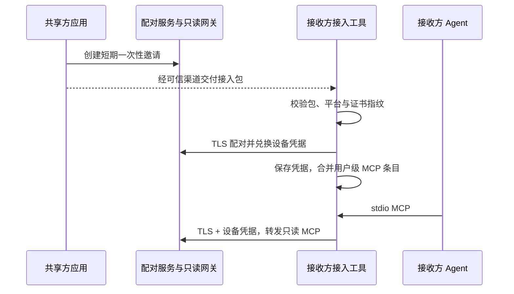

# 内网 MCP 无应用接收端分发方案

状态：设计，尚未实现。读者是维护飞书同步和接入工具的开发者。目标是让共享方生成一个接入包，接收方无需安装飞书同步，运行接入工具后即可把只读知识库加入自己的 Agent 配置。

## 现状与边界

现有内网 MCP 已有只读工具、网段限制、共享令牌、审计和客户端 JSON 片段。网关目前使用 HTTP，只有一个共享令牌，轮换会影响所有客户端；也没有配对码、接入包或独立撤销设备的界面。因此现有“复制配置”和“复制令牌”是手动接入，不应展示为已完成的一键分发。

新方案只读取**已发布的标准库**。接收方不能通过分发工具访问原始库、改动标准库或管理共享设置。共享方的设备仍须运行应用、保持内网可达；休眠、换网或防火墙会导致连接中断。

## 用户流程

1. 共享方在「知识库共享」启用服务，选择目标平台并点击「生成接入包」。应用生成一个有有效期和使用次数的邀请，在界面显示共享地址、过期时间和撤销入口。
2. 共享方通过可信渠道把接入包发给接收者。包内是对应平台的独立接入工具和邀请信息，不包含共享方现有的长期令牌。
3. 接收方运行工具，看到共享方名称、地址和证书指纹，选择 `.agents` 或 Claude Code，确认后完成配对。工具写入一个独立的 `feishu-kb-lan-<主机标识>` 条目，保留其余配置；完成后提示重启 Agent。
4. 接收方不安装飞书同步。接入工具将一个体积较小的连接程序留在当前用户目录；该程序作为 stdio MCP 桥接器，读取本机凭据并连接共享网关。接收者可在工具中清理条目及对应凭据。
5. 共享方在设备列表查看最后访问时间并单独撤销某台设备。撤销后该设备的连接断开，其他设备不受影响。

## 组成与数据流



接入工具需针对 Windows x64 和 macOS x64/arm64 交付可验证的二进制；接收方无需另装 Node、Python 或飞书同步。Windows 和 macOS 发布包应分别签名；macOS 包还需完成公证。若不能验证工具来源，接收方不应运行该包。

### 邀请包格式

邀请数据由应用序列化为版本化文件，和平台工具一起打包：

```json
{
  "version": 1,
  "serverId": "stable-random-id",
  "displayName": "策划标准库",
  "endpoint": "https://192.168.1.23:47391",
  "certificateSha256": "服务证书指纹",
  "inviteId": "随机邀请标识",
  "pairingCode": "短期一次性配对码",
  "expiresAt": "2026-11-01T10:00:00Z"
}
```

该文件不是公开链接；配对码到期、被使用或撤销后不能再兑换。证书指纹随包交付只能防止连接时的证书替换，不能证明包本身的来源；可信分发渠道和工具签名仍然必要。不要把配对码放入 URL、进程参数、日志或版本库。

### 配对与凭据

新增仅供接入工具使用的 HTTPS 配对接口，例如 `POST /pair`，请求体包含邀请 ID 和配对码。服务端校验网段、有效期、使用状态和请求频率，再一次性签发该设备的只读 bearer 凭据；凭据保持现有 `fskb_` 格式。服务端保存凭据摘要，网关通过 TLS 收到 bearer 后计算摘要并比对。配对码使用固定时间比较，成功消费和凭据登记必须在同一持久化事务中完成。

配对响应丢失时，接收方需让共享方重新生成邀请；不能用已消费的码再次签发。配对、过期、失败和撤销事件写审计，但不得记录配对码、明文凭据或文档内容。为现有共享令牌保留兼容路径；新增凭据按设备单独管理和撤销。

网关需要新增 TLS，接入工具按邀请包中的 SHA-256 指纹校验证书；证书变化时停止连接并要求重新配对，不能自动降级到 HTTP。现有 HTTP 模式可以继续供用户主动选择的旧客户端使用，但不用于新的接入包。服务器证书和私钥应只保存在共享方受保护的数据目录，证书轮换需清晰提示设备重新配对。

接收方的长期凭据放入系统凭据库，配置文件只保存本地桥接程序路径和不含秘密的服务器标识。Windows 使用 Credential Manager，macOS 使用 Keychain；凭据库不可用时停止并给出明确提示，不静默把令牌写入用户已有 JSON。清理时只删除安装记录中仍与工具写入值一致的条目和对应凭据；同名冲突或外部修改时停止，保留现状。

### 数据与管理接口

服务端需新增两类记录，均放在应用私有数据目录，文件写入采用原子替换；接口只在已认证的桌面管理域暴露：

- `invite`：随机 ID、配对码摘要、有效期、剩余次数、创建时间、状态。桌面端只在生成时取得明文一次。
- `device`：随机 ID、显示名、凭据摘要、创建时间、最后访问时间、撤销时间。列表接口不返回明文凭据。

管理接口包括创建/撤销邀请、列出/撤销设备；操作需复用桌面令牌和 CLI 身份隔离。网关启动时接收有效摘要与设备 ID 的映射；会话建立时绑定设备 ID，每次请求都验证其凭据，不能仅依赖来源 IP。新增或撤销设备后要同步更新认证状态，并在撤销完成前断开该设备已有会话。更改或停用共享的同时处理过期邀请，不复活旧凭据。

接收侧复用本次本机安装的配置保护原则，但注册名、安装登记、可执行文件与凭据应按 `serverId` 隔离，以便同时连接多个共享库。安装失败不得留下半套配置：若写配置或保存凭据失败，回滚本次写入；若文件被外部并发修改，停止回滚并提示人工检查，不能覆盖新修改。

## 设计决策与取舍

- **独立接入工具而非远程推送安装**：共享方无需获得其他设备的系统权限；代价是接收方仍需运行一次可信工具并确认目标。
- **独立设备凭据而非复用现有共享令牌**：单设备泄露可单独撤销；代价是需扩展令牌存储、网关热更新和管理界面。
- **本地 stdio 桥接而非在现有 JSON 中写明文 bearer**：不改变用户配置文件的保密属性，也不依赖客户端对环境变量替换的差异；代价是需要为各平台维护一个小型连接程序。
- **证书固定的 TLS 而非直接分发 HTTP 地址和长期令牌**：避免在内网传输可复用明文令牌；代价是证书轮换时必须重新配对，并依赖可信渠道交付邀请包。

## 实施顺序与验收

1. 先为网关增加 TLS、证书固定、短期邀请和设备凭据管理，保持现有手动 HTTP 客户端兼容。
2. 再制作各平台接入工具与 stdio 桥接器，验证凭据库、配置合并、卸载、冲突和回滚。
3. 最后接入「生成接入包」、邀请和设备管理界面；在两台真实设备上验证全流程。

验收至少覆盖：有效邀请一次接入；过期、重放和撤销失败；单设备撤销不影响其他设备；伪造证书和公网来源被拒绝；配置文件的其他条目、权限与用户更改得到保留；发送端或接收端重启后可恢复连接；关停服务和更换地址后显示可理解的错误。测试日志、截图和打包产物不得包含真实配对码或凭据。
